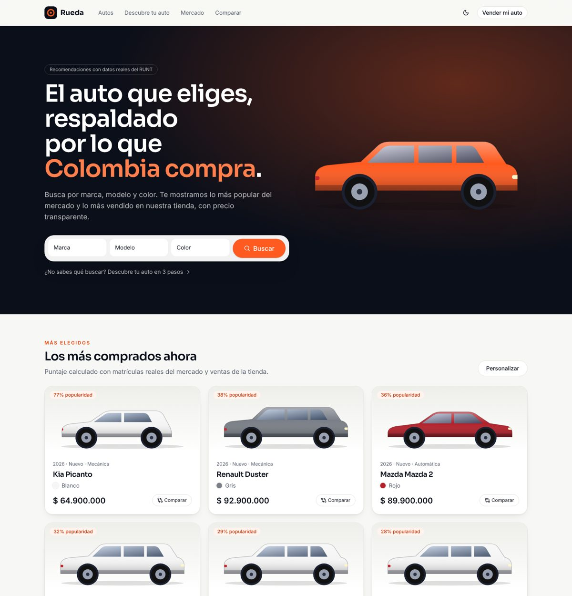
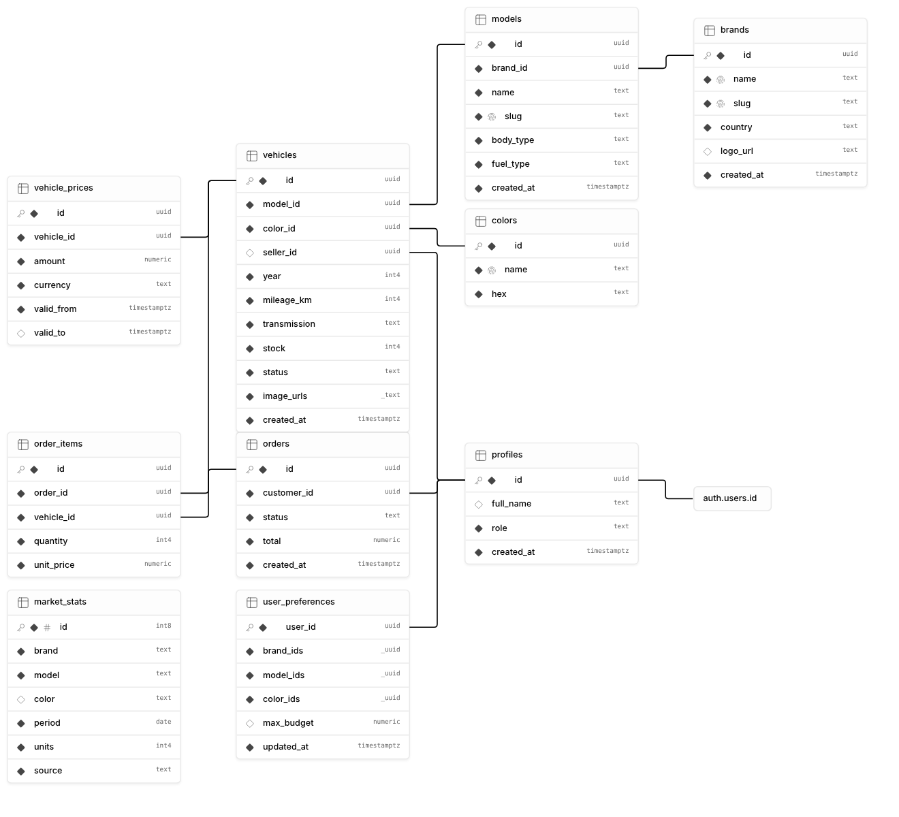
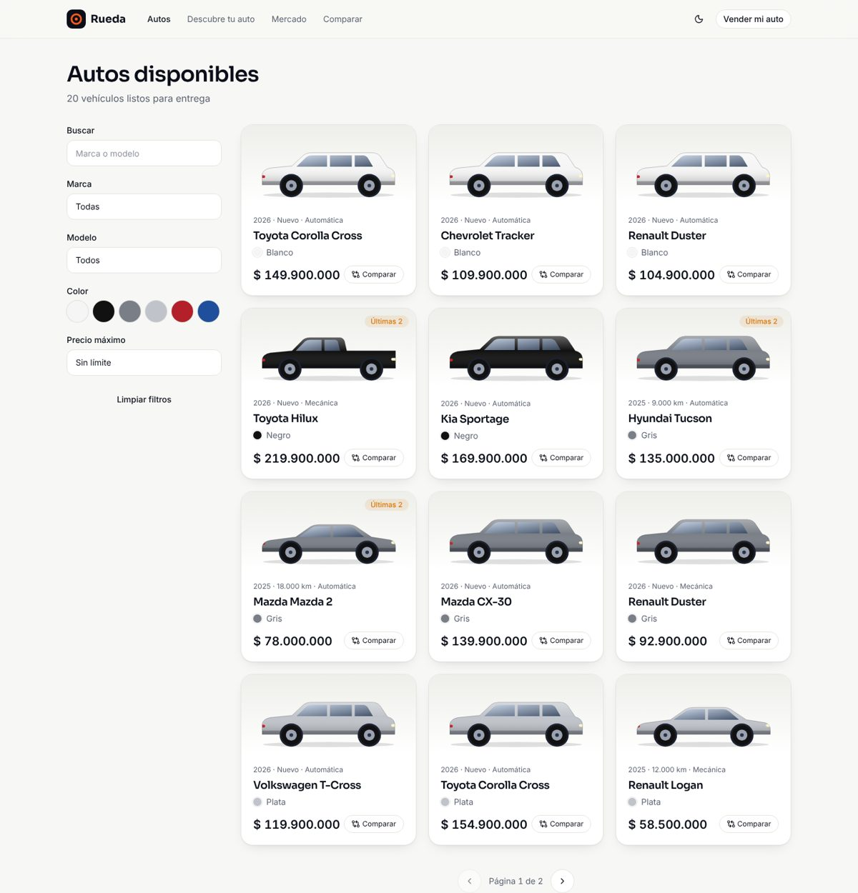
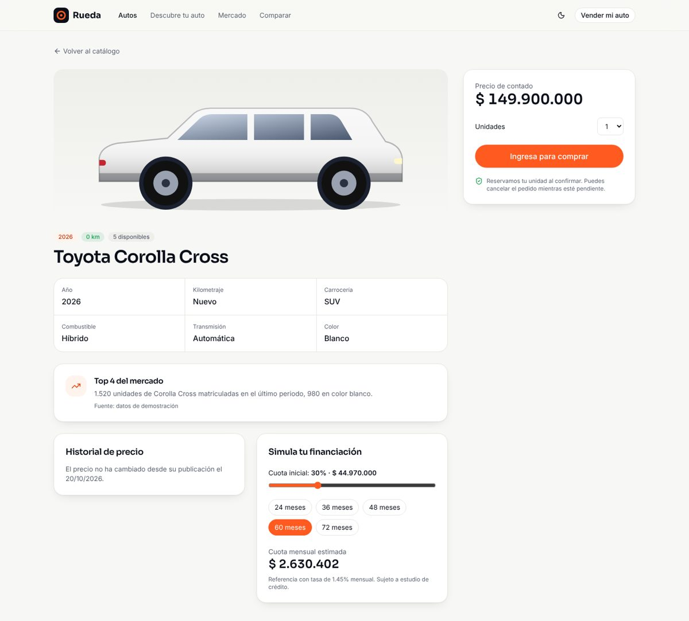
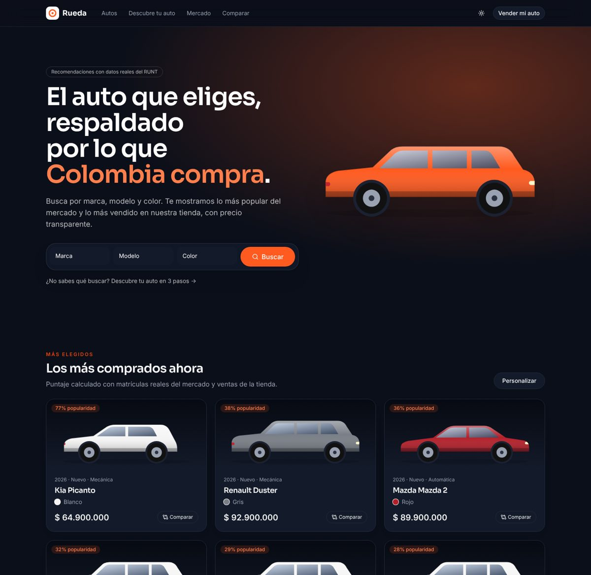

# Rueda · Tienda de automóviles con recomendaciones basadas en datos reales

Prueba técnica full stack (backend, frontend y DevOps). Catálogo, inventario con stock,
compras, panel de administración y un motor de recomendaciones que combina las preferencias
del usuario con **el parque automotor real registrado en Colombia (datos.gov.co)** y con las
ventas de la propia tienda.



## Demo en vivo

| Qué | URL |
|---|---|
| Tienda (web) | https://rueda-autos.vercel.app |
| API REST | https://autos-store-api.vercel.app/api |
| Documentación Swagger | https://autos-store-api.vercel.app/api/docs |
| Estado de la API y la base de datos | https://autos-store-api.vercel.app/api/health |

Desplegado en los planes gratuitos de Vercel (web y API serverless) y Supabase (Postgres y Auth).
Para comprar hay que crear una cuenta desde **Ingresar**. La primera petición tras un rato sin uso
puede tardar unos segundos mientras la función arranca. La raíz de la API (`/`) responde 404 a
propósito: todos los endpoints viven bajo `/api`.

## Qué incluye

| Requisito | Dónde |
|---|---|
| CRUD de autos, marcas, modelos, colores y precios | API `/brands`, `/models`, `/colors`, `/vehicles`, `/vehicles/:id/prices` · Admin › Catálogo / Vehículos |
| Administrador para visualizar vehículos | `/admin` (métricas, stock bajo, aprobación, pedidos) |
| Registro de vehículos con cantidad | Admin › Vehículos y `/vender` (clientes; queda en revisión) |
| Compra de autos | Ficha del vehículo → `POST /orders` (transacción, sin sobreventa) |
| Lista de disponibles + recomendaciones | `/autos` con filtros en la URL · `/descubre` (onboarding en 3 pasos) |
| Lo más comprado según lo que el usuario escoge | Estrategias de mercado + ventas + preferencias (`docs/architecture.md`) |

Diferenciadores: puntaje de afinidad explicado ("por qué te lo recomendamos"), pulso del
mercado con gráfica y tabla, comparador de hasta 3 autos que resalta al ganador por fila,
historial de precio transparente, simulador de financiación, ilustraciones pintadas con el
color real del vehículo, modo oscuro y diseño accesible (WCAG AA, teclado, `prefers-reduced-motion`).

## Stack

- **API**: NestJS 12, Drizzle ORM, Zod, Swagger, eventos de dominio · arquitectura hexagonal.
- **Web**: React 19, Vite, TanStack Query, React Router, Tailwind CSS 4, Motion, Recharts.
- **Datos y auth**: Supabase (Postgres + Auth + RLS).
- **Calidad**: Vitest, Testing Library, Playwright (escritorio y móvil), ESLint estricto.
- **DevOps**: pnpm workspaces + Turborepo, GitHub Actions (CI + E2E con Postgres + cron), Vercel.

## Calidad de código

- **Ningún archivo supera 60 líneas** (`pnpm check:lines`, falla en CI).
- Funciones ≤ 40 líneas, complejidad ciclomática ≤ 8, máximo 4 parámetros.
- 18 patrones aplicados donde resuelven un problema: ver [docs/patterns.md](docs/patterns.md).
- Decisiones documentadas en [docs/adr](docs/adr).

## Ejecutar en local

```bash
pnpm install
cp apps/api/.env.example apps/api/.env   # completa DATABASE_URL y SUPABASE_URL
cp apps/web/.env.example apps/web/.env
DATABASE_URL=postgresql://... scripts/db-setup.sh   # Postgres local sin Supabase
pnpm dev                                            # API :3000 · web :5173
```

API docs: `http://localhost:3000/api/docs`.

```bash
pnpm turbo run lint typecheck test build   # lo mismo que CI
pnpm --filter @autos/web e2e               # con API y `vite preview` levantados
```

## Estructura

```
apps/api        NestJS (módulos: brands, models, colors, vehicles, pricing, orders,
                market-data, recommendations, admin, health)
apps/web        React (features: home, catalog, vehicle-detail, discover, compare,
                market, orders, sell, auth, admin)
packages/contracts   esquemas Zod y tipos compartidos
supabase        migraciones, RLS y seed
docs            arquitectura, patrones, ADRs, despliegue y herramientas
```

## Modelo de datos



Detalle de relaciones en [docs/architecture.md](docs/architecture.md#modelo-de-datos).

## Despliegue

Guía paso a paso para Supabase y Vercel en plan gratuito: [docs/deploy.md](docs/deploy.md).

## Datos de mercado

La API sincroniza cada semana un conjunto de datos abierto de datos.gov.co (Socrata). Hasta la
primera sincronización la interfaz muestra datos de **demostración**, rotulados como tales.
Detalle y pendientes en [ADR 0004](docs/adr/0004-datos-de-mercado.md).

| Catálogo | Ficha | Modo oscuro |
|---|---|---|
|  |  |  |
