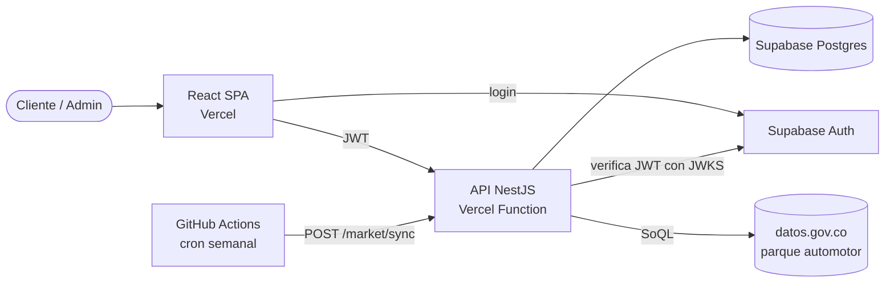
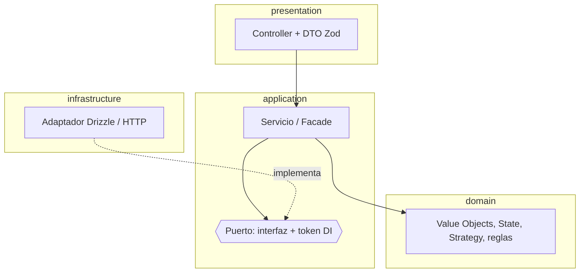
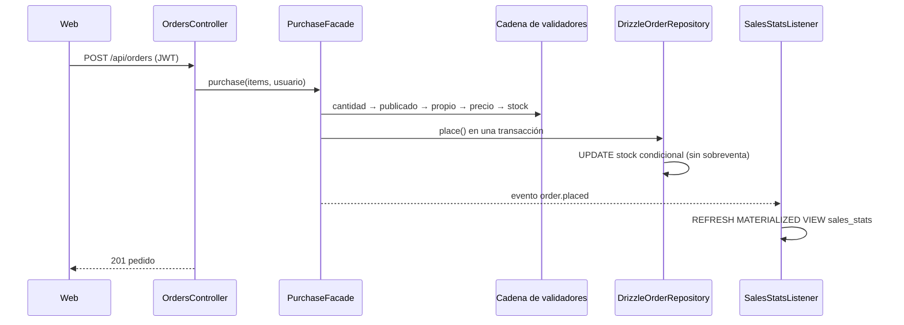
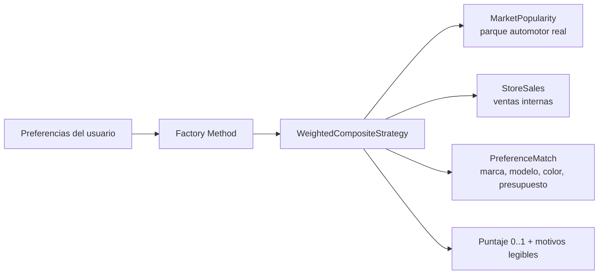
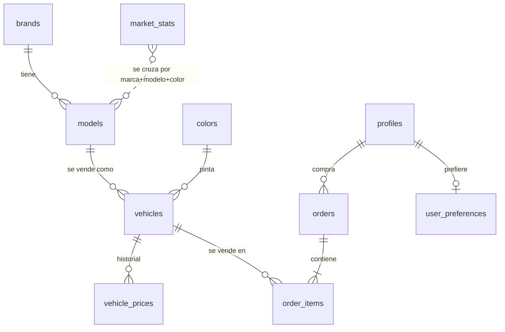

# Arquitectura

## Vista general

## Capas de cada módulo (arquitectura hexagonal)

El dominio no importa NestJS ni Drizzle. Los adaptadores se enlazan a los puertos en el
`*.module.ts` (`{ provide: TOKEN, useClass: Adaptador }`), así que cambiar la base de
datos o la fuente de mercado no toca la lógica de negocio.

## Flujo de compra

## Recomendaciones

| Escenario | Preferencias | Mercado | Ventas tienda |
|---|---|---|---|
| Sin preferencias | – | 70 % | 30 % |
| Con preferencias | 60 % | 30 % | 10 % |

## Modelo de datos

Para diagramas interactivos (rutas, foco upstream/downstream, exportar PNG/PDF) se usa
[Archify](https://github.com/tt-a1i/archify): `npx skills add tt-a1i/archify -g` y luego
pedir en Claude Code "mapea la arquitectura de este repositorio".
