# Diagramas del sistema

Todos los diagramas se generaron con [Archify](https://github.com/tt-a1i/archify) a partir del código del repositorio. Cada uno es una página HTML interactiva: se puede hacer zoom, cambiar entre tema claro y oscuro, hacer clic en cada elemento para ver su explicación y los archivos que lo respaldan, y exportar a PNG, SVG o video.

**Galería en vivo:** https://rueda-autos.vercel.app/diagramas/index.html (disponible después del despliegue de `main`).

| Carpeta | Contenido |
|---|---|
| [`apps/web/public/diagramas/`](../apps/web/public/diagramas/) | Páginas HTML que publica Vercel junto a la web |
| [`docs/diagramas/fuentes/`](diagramas/fuentes/) | Descripción JSON de cada diagrama (lo que se edita para regenerarlo) |
| [`docs/diagramas/img/`](diagramas/img/) | Vista previa en PNG para leer en GitHub |

Los patrones que aparecen en los diagramas de clases se explican en [patterns.md](patterns.md). La propuesta de crecimiento está en [escalabilidad.md](escalabilidad.md).

## Índice

- **Arquitectura y componentes:** [Arquitectura del sistema desplegado](#arquitectura), [Componentes de la API (módulos NestJS)](#componentes)
- **Diagramas de clases (patrones de diseño):** [Recomendaciones: Strategy, Composite y Factory Method](#clases-recomendaciones), [Compra: Facade, Chain of Responsibility, Unit of Work y Observer](#clases-compra), [Reglas de compra: Chain of Responsibility y Value Object](#clases-validaciones), [Estados del pedido: State](#clases-estado-pedido), [Datos de mercado: Adapter y Decorator](#clases-mercado), [Catálogo: Template Method, Repository genérico y Builder](#clases-catalogo), [Autenticación y roles: Ports & Adapters](#clases-autenticacion)
- **Diagramas de secuencia:** [Compra de un vehículo](#secuencia-compra), [Inicio de sesión y autorización por rol](#secuencia-inicio-sesion), [Sincronización semanal de datos de mercado](#secuencia-sincronizacion-mercado)
- **Diagramas de ciclo de vida:** [Ciclo de vida del pedido](#ciclo-pedido), [Ciclo de vida del vehículo en inventario](#ciclo-vehiculo)
- **Diagramas de flujo:** [Compra de principio a fin](#flujo-compra), [Recomendaciones de *Descubre tu auto*](#flujo-recomendaciones)
- **Modelo de datos:** [Modelo relacional](#modelo-relacional)
- **Propuesta:** [escalabilidad](escalabilidad.md)

## Arquitectura y componentes

<a id="arquitectura"></a>

### Arquitectura del sistema desplegado

[Abrir interactivo](https://rueda-autos.vercel.app/diagramas/arquitectura.html) · [fuente](diagramas/fuentes/arquitectura.architecture.json)

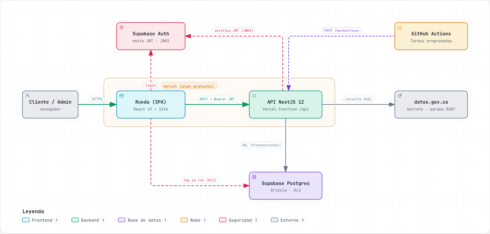

Vista de alto nivel: el navegador carga la SPA de React desde Vercel (`rueda-autos`), que llama a la API NestJS desplegada como una función serverless (`autos-store-api`). La API valida los JWT de Supabase Auth contra su JWKS público, lee y escribe en Postgres (Supabase) con Drizzle y consulta los datos abiertos del RUNT en datos.gov.co. GitHub Actions dispara la sincronización semanal de mercado y un ping de salud cada tres días.

- Haz clic en cada componente para ver su responsabilidad y los archivos del repositorio que lo respaldan.
- Las tarjetas inferiores resumen despliegue, seguridad (JWKS, RLS, `x-cron-secret`) y el ciclo de los datos de mercado.

<a id="componentes"></a>

### Componentes de la API (módulos NestJS)

[Abrir interactivo](https://rueda-autos.vercel.app/diagramas/componentes.html) · [fuente](diagramas/fuentes/componentes.architecture.json)

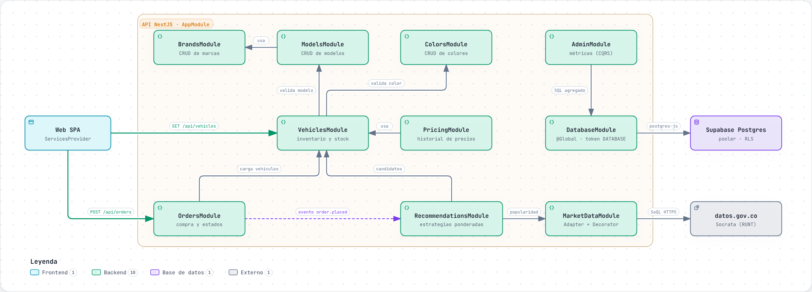

Los 13 módulos de la API y cómo dependen entre sí. Las flechas sólidas son imports de Nest (un módulo usa un servicio exportado por otro); la flecha punteada es un evento de dominio: Pedidos no conoce a Recomendaciones, solo emite `order.placed` y `order.status-changed`.

- Muestra que `DatabaseModule` y `AuthModule` son globales y que cada módulo enlaza sus puertos a adaptadores Drizzle en su `*.module.ts`.
- Recuerda las cuatro capas de cada módulo: presentation, application, domain e infrastructure.

## Diagramas de clases (patrones de diseño)

<a id="clases-recomendaciones"></a>

### Recomendaciones: Strategy, Composite y Factory Method

[Abrir interactivo](https://rueda-autos.vercel.app/diagramas/clases-recomendaciones.html) · [fuente](diagramas/fuentes/clases-recomendaciones.class.json)

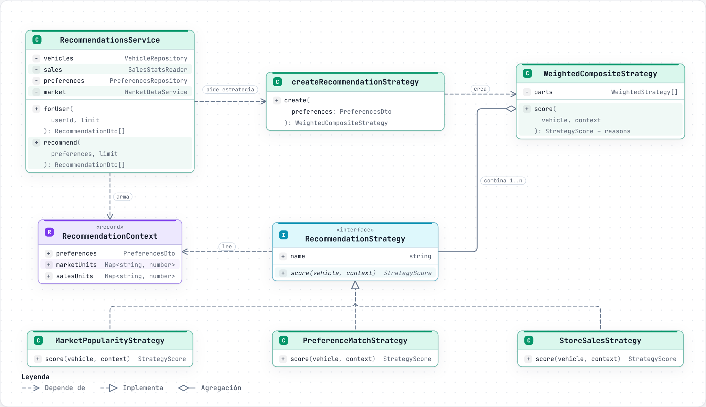

`RecommendationStrategy` es la interfaz común; `MarketPopularityStrategy`, `StoreSalesStrategy` y `PreferenceMatchStrategy` devuelven un puntaje de 0 a 1 con un motivo legible. `WeightedCompositeStrategy` combina varias con pesos y `createRecommendationStrategy` elige la mezcla: 70/30 (mercado/ventas) sin preferencias y 60/30/10 (preferencias/mercado/ventas) con ellas.

- Agregar un algoritmo nuevo es crear una clase y sumarla en la fábrica; el servicio no cambia.

<a id="clases-compra"></a>

### Compra: Facade, Chain of Responsibility, Unit of Work y Observer

[Abrir interactivo](https://rueda-autos.vercel.app/diagramas/clases-compra.html) · [fuente](diagramas/fuentes/clases-compra.class.json)

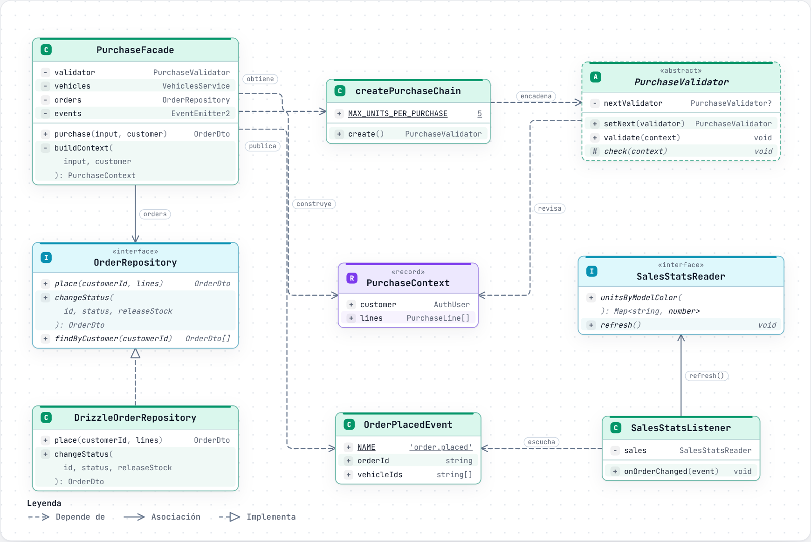

`PurchaseFacade` esconde todo el proceso detrás de `purchase()`: carga los vehículos, ejecuta la cadena de validadores, llama a `DrizzleOrderRepository.place` (una sola transacción que descuenta stock y crea el pedido) y emite el evento que escucha `SalesStatsListener`.

- El UPDATE de stock es condicional (`stock >= cantidad`), así que dos compras simultáneas de la última unidad nunca producen sobreventa.

<a id="clases-validaciones"></a>

### Reglas de compra: Chain of Responsibility y Value Object

[Abrir interactivo](https://rueda-autos.vercel.app/diagramas/clases-validaciones.html) · [fuente](diagramas/fuentes/clases-validaciones.class.json)

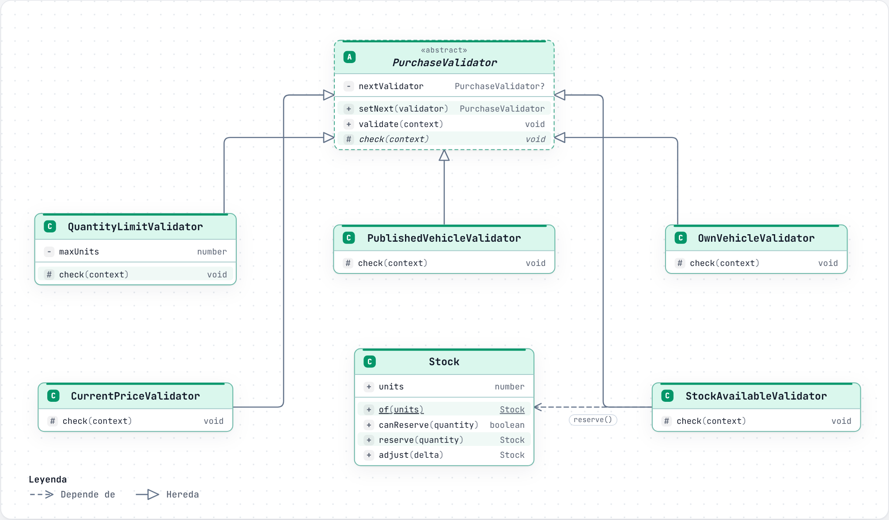

Detalle de la cadena que arma `createPurchaseChain`: cantidad → publicado → propio → precio → stock. Cada `PurchaseValidator` revisa una regla y delega en el siguiente; el primero que falla lanza `BusinessRuleError` (HTTP 422) sin tocar la base de datos. `Stock` es un Value Object inmutable que nunca queda negativo.

<a id="clases-estado-pedido"></a>

### Estados del pedido: State

[Abrir interactivo](https://rueda-autos.vercel.app/diagramas/clases-estado-pedido.html) · [fuente](diagramas/fuentes/clases-estado-pedido.class.json)

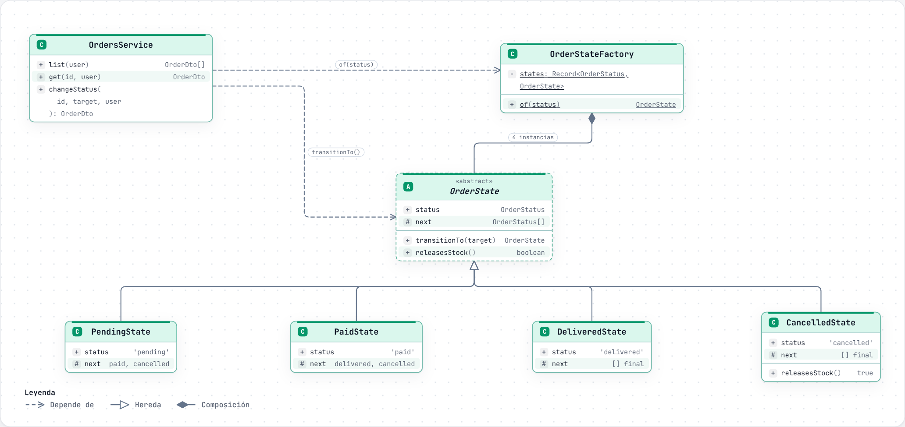

Cada estado (`PendingState`, `PaidState`, `DeliveredState`, `CancelledState`) declara a qué estados puede pasar. `transitionTo` rechaza los cambios no permitidos y `CancelledState` es el único que libera stock.

<a id="clases-mercado"></a>

### Datos de mercado: Adapter y Decorator

[Abrir interactivo](https://rueda-autos.vercel.app/diagramas/clases-mercado.html) · [fuente](diagramas/fuentes/clases-mercado.class.json)

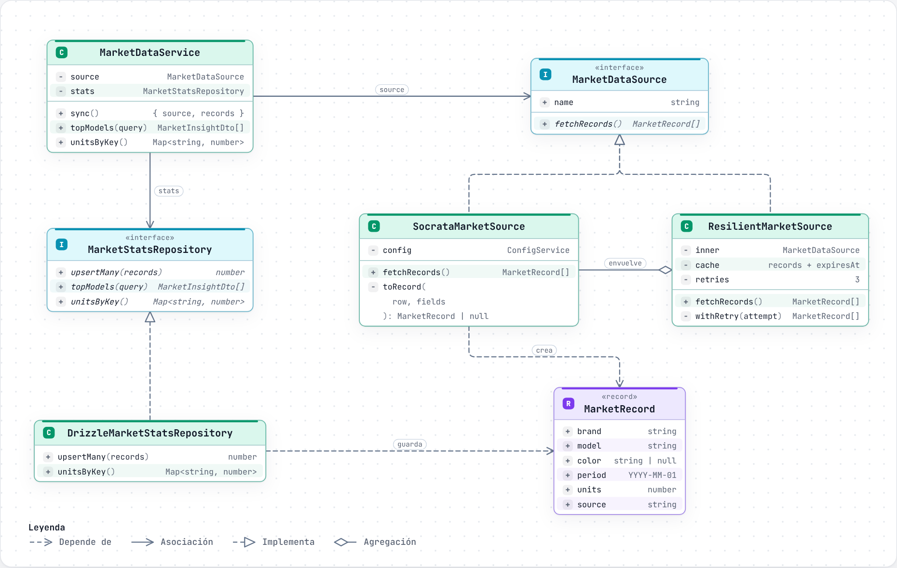

`SocrataMarketSource` adapta las filas del dataset del RUNT al tipo `MarketRecord`; `ResilientMarketSource` implementa el mismo puerto y agrega 3 reintentos con espera exponencial y una caché de 1 hora. `MarketDataModule` los compone con `useFactory`.

- Cambiar de proveedor de datos es escribir otro adaptador (ver [ADR 0004](adr/0004-datos-de-mercado.md)).

<a id="clases-catalogo"></a>

### Catálogo: Template Method, Repository genérico y Builder

[Abrir interactivo](https://rueda-autos.vercel.app/diagramas/clases-catalogo.html) · [fuente](diagramas/fuentes/clases-catalogo.class.json)

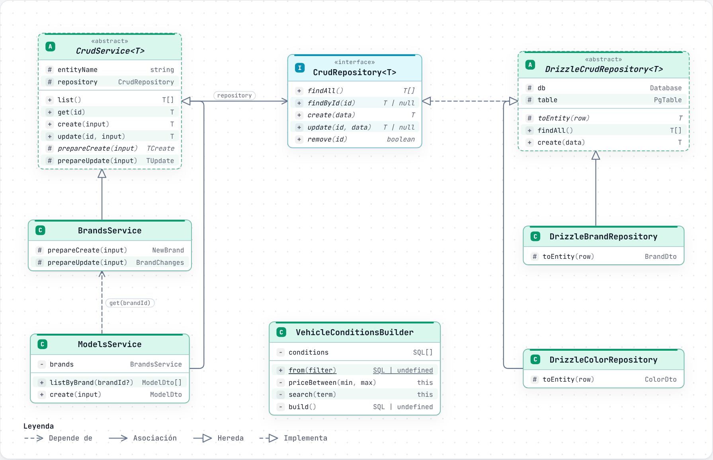

`CrudService` fija el flujo list/get/create/update/remove y cada servicio (marcas, modelos, colores) solo define `prepareCreate`. `DrizzleCrudRepository` implementa el CRUD una vez para todas las tablas y `VehicleConditionsBuilder` arma el WHERE solo con los filtros enviados.

<a id="clases-autenticacion"></a>

### Autenticación y roles: Ports & Adapters

[Abrir interactivo](https://rueda-autos.vercel.app/diagramas/clases-autenticacion.html) · [fuente](diagramas/fuentes/clases-autenticacion.class.json)

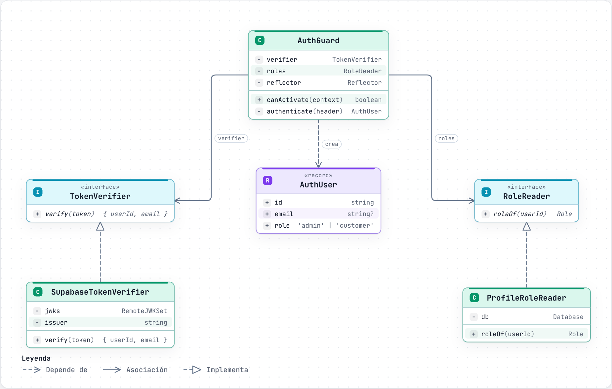

`AuthGuard` depende de dos puertos, `TokenVerifier` y `RoleReader`, que `AuthModule` enlaza a `SupabaseTokenVerifier` (JWKS) y `ProfileRoleReader` (tabla `profiles`). El decorador `@Auth('admin')` declara el rol requerido.

- En las pruebas los puertos se reemplazan por dobles sin tocar el guard.

## Diagramas de secuencia

<a id="secuencia-compra"></a>

### Compra de un vehículo

[Abrir interactivo](https://rueda-autos.vercel.app/diagramas/secuencia-compra.html) · [fuente](diagramas/fuentes/secuencia-compra.sequence.json)

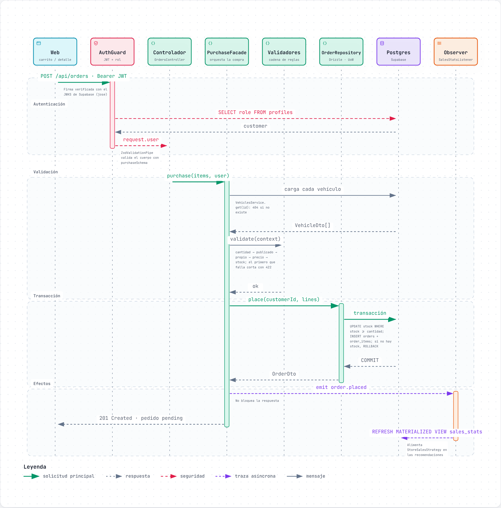

Mensaje por mensaje desde que el usuario confirma la compra: AuthGuard → pipe de Zod → controlador → fachada → validadores → transacción en Postgres → evento asíncrono. Incluye los fragmentos de error (401, 403, 422) y la carrera por la última unidad.

- Pulsa reproducir para ver los mensajes en orden; cada uno enlaza al archivo y las líneas que lo implementan.

<a id="secuencia-inicio-sesion"></a>

### Inicio de sesión y autorización por rol

[Abrir interactivo](https://rueda-autos.vercel.app/diagramas/secuencia-inicio-sesion.html) · [fuente](diagramas/fuentes/secuencia-inicio-sesion.sequence.json)

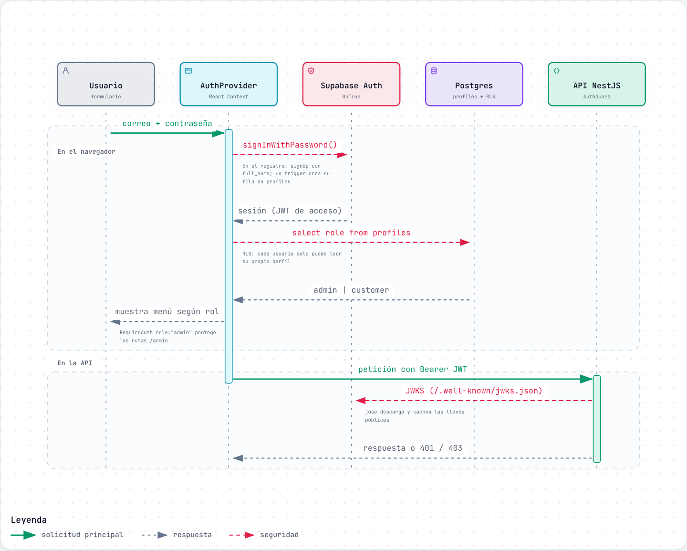

El `AuthProvider` de la web inicia sesión en Supabase Auth, guarda la sesión y envía el JWT en cada petición. La API valida la firma y lee el rol desde `profiles` con su propia conexión: nunca confía en el rol que manda el navegador.

<a id="secuencia-sincronizacion-mercado"></a>

### Sincronización semanal de datos de mercado

[Abrir interactivo](https://rueda-autos.vercel.app/diagramas/secuencia-sincronizacion-mercado.html) · [fuente](diagramas/fuentes/secuencia-sincronizacion-mercado.sequence.json)

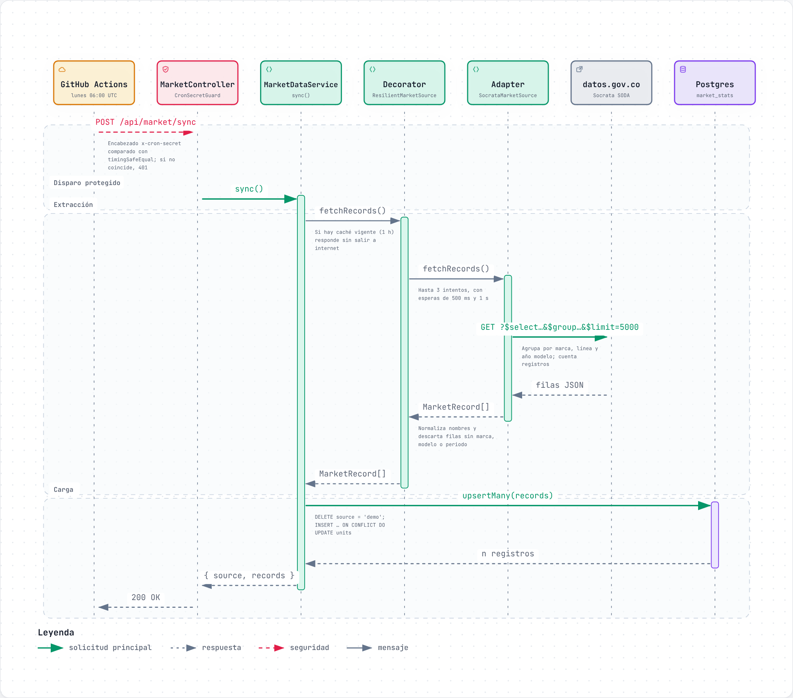

Cada lunes a las 06:00 UTC el workflow *Tareas programadas* llama a `POST /api/market/sync` con `x-cron-secret`. El servicio pide los datos al Decorator, que reintenta y cachea, el Adapter consulta datos.gov.co y el resultado se guarda con un upsert idempotente en `market_stats`.

## Diagramas de ciclo de vida

<a id="ciclo-pedido"></a>

### Ciclo de vida del pedido

[Abrir interactivo](https://rueda-autos.vercel.app/diagramas/ciclo-pedido.html) · [fuente](diagramas/fuentes/ciclo-pedido.lifecycle.json)

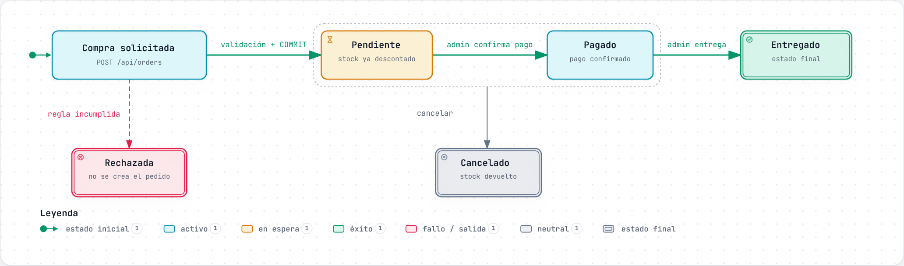

Pendiente → pagado → entregado es el camino principal; desde pendiente o pagado se puede cancelar (devuelve las unidades al stock). Una compra que no pasa las validaciones nunca llega a existir como pedido. Pagar y entregar son acciones del admin; el cliente solo puede cancelar sus propios pedidos.

<a id="ciclo-vehiculo"></a>

### Ciclo de vida del vehículo en inventario

[Abrir interactivo](https://rueda-autos.vercel.app/diagramas/ciclo-vehiculo.html) · [fuente](diagramas/fuentes/ciclo-vehiculo.lifecycle.json)

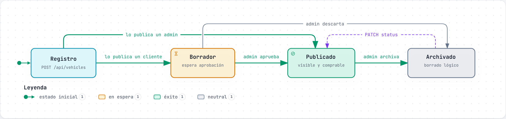

Un vehículo nace en borrador (si lo registra un cliente) o con el estado que elija el admin. Solo los publicados aparecen en el catálogo y en la política RLS. Archivar es un borrado lógico: la fila se conserva porque `order_items` la referencia.

- El stock no es un estado: un publicado con stock 0 sigue publicado, pero no aparece entre los disponibles.

## Diagramas de flujo

<a id="flujo-compra"></a>

### Compra de principio a fin

[Abrir interactivo](https://rueda-autos.vercel.app/diagramas/flujo-compra.html) · [fuente](diagramas/fuentes/flujo-compra.workflow.json)

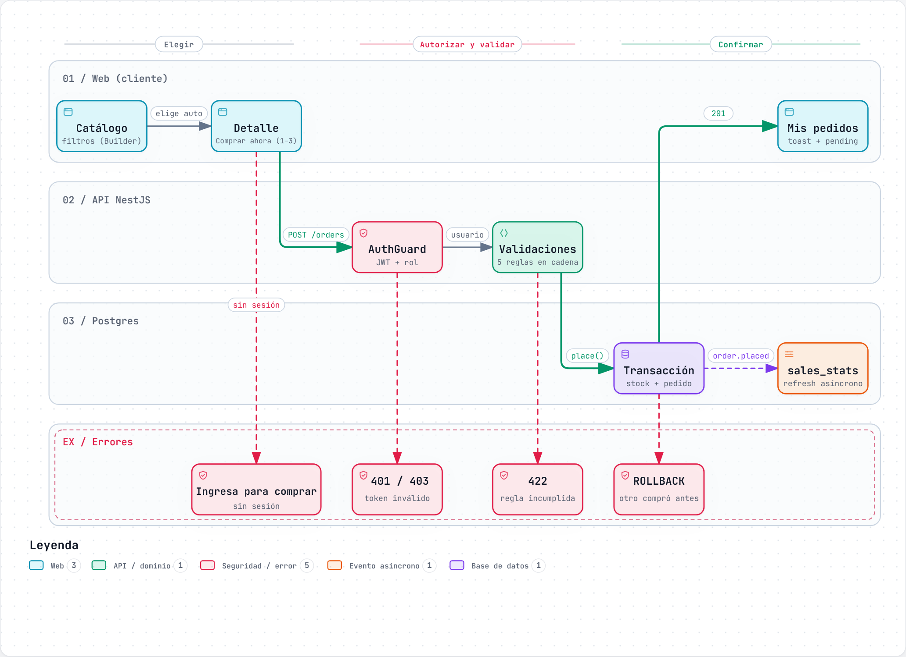

Recorrido por carriles (Web, API, Base de datos) desde el catálogo hasta *Mis pedidos*, con cada salida de error: sin sesión, 401/403, reglas de negocio (422) y ROLLBACK cuando otra compra gana la última unidad.

<a id="flujo-recomendaciones"></a>

### Recomendaciones de *Descubre tu auto*

[Abrir interactivo](https://rueda-autos.vercel.app/diagramas/flujo-recomendaciones.html) · [fuente](diagramas/fuentes/flujo-recomendaciones.workflow.json)

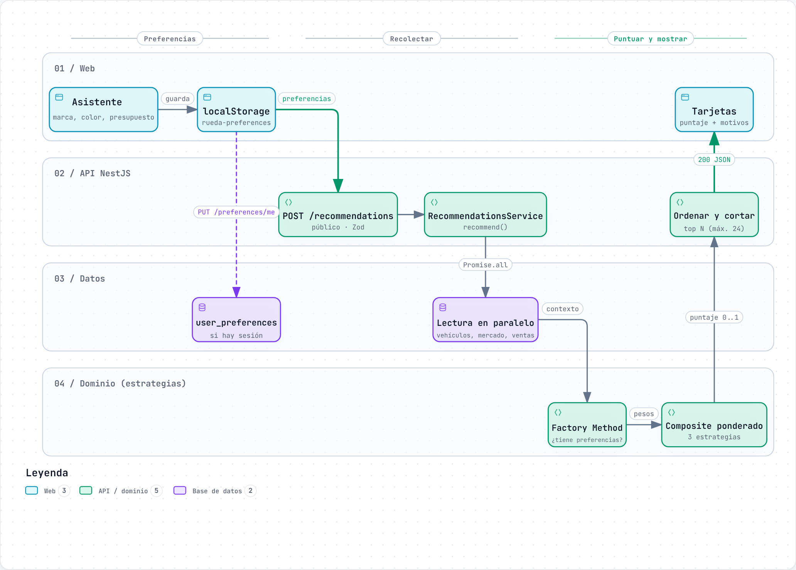

Desde el asistente hasta las tarjetas: las preferencias se guardan en `localStorage` (y en `user_preferences` si hay sesión), la API lee en paralelo vehículos, mercado y ventas, la fábrica elige la estrategia, el Composite pondera y se devuelven los mejores resultados con su motivo.

## Modelo de datos

<a id="modelo-relacional"></a>

### Modelo relacional

[Abrir interactivo](https://rueda-autos.vercel.app/diagramas/modelo-relacional.html) · [fuente](diagramas/fuentes/modelo-relacional.erd.json)

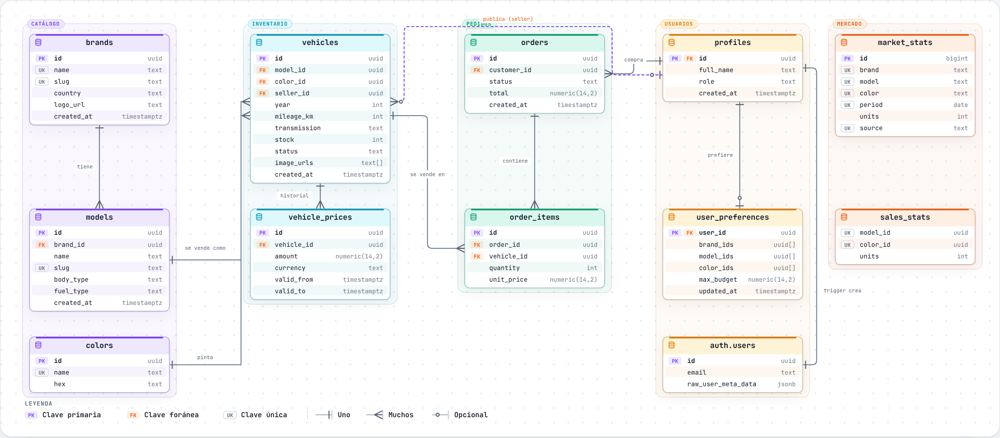

Las 12 tablas y vistas con sus llaves y relaciones, agrupadas en catálogo, inventario, pedidos, usuarios y mercado. Es la versión interactiva del [diagrama que entrega Supabase](diagrams/modelo-relacional.png).

- `market_stats` y `sales_stats` aparecen sin llaves foráneas a propósito: el mercado del RUNT incluye miles de modelos que la tienda no vende y `sales_stats` es una vista materializada.

## Propuesta de escalabilidad

[Abrir interactivo](https://rueda-autos.vercel.app/diagramas/escalabilidad.html) · [documento completo](escalabilidad.md)

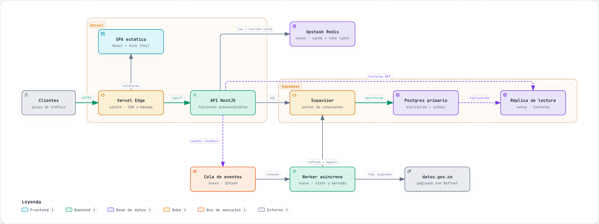

El diagrama marca con *nuevo ·* los componentes que se agregarían (CDN con caché, Redis, Outbox, worker y réplica de lectura) y las tres fases para llegar a ellos.

## Cómo regenerarlos

```bash
npx skills add tt-a1i/archify -g
# Edita docs/diagramas/fuentes/<nombre>.<tipo>.json y vuelve a generar el HTML:
node ~/.agents/skills/archify/bin/archify.mjs finalize <tipo> docs/diagramas/fuentes/<nombre>.<tipo>.json \
  apps/web/public/diagramas/<nombre>.html --repo-root . --quality showcase
```

Cada fuente fija en `meta.repository.revision` el commit con el que se verificaron los rangos de líneas; si el código cambia, actualiza esa revisión y los rangos antes de regenerar.
